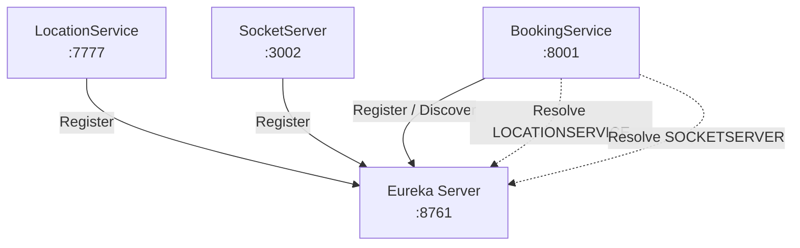

# RideFlow Service Discovery

RideFlow Service Discovery is the platform's **Netflix Eureka Server**.

It acts as a central registry where participating RideFlow services register themselves and discover other services using logical application names instead of fixed host and port values.

---

## What This Repository Implements

```text
Service Discovery
       |
       +-- service registration
       +-- heartbeat tracking
       +-- service lookup
       +-- Eureka dashboard
```

Current Eureka clients include:

```text
LocationService
BookingService
SocketServer
```

Auth Service and Review Service currently run independently without Eureka registration.

---

## Runtime

| Property    | Value                 |
| ----------- | --------------------- |
| Application | `ServiceDiscovery`    |
| Port        | `8761`                |
| Java        | 17                    |
| Spring Boot | 4.1.1                 |
| Discovery   | Netflix Eureka Server |

---

## Architecture



---

## Configuration

```properties
spring.application.name=ServiceDiscovery

server.port=8761

eureka.instance.hostname=my-registry

eureka.client.register-with-eureka=false
eureka.client.fetch-registry=false
```

The Eureka server does not register itself as another Eureka client.

---

## Running Locally

### Prerequisite

```text
JDK 17+
```

### Linux / macOS

```bash
./gradlew bootRun
```

### Windows

```bash
gradlew.bat bootRun
```

---

## Eureka Dashboard

After starting the service, open:

```text
http://localhost:8761
```

When the Eureka-enabled RideFlow services start successfully, applications such as these should appear:

```text
BOOKINGSERVICE
LOCATIONSERVICE
SOCKETSERVER
```

The dashboard is useful for checking:

* whether services are registered
* how many instances are running
* service application names
* instance host/IP information
* whether a service is available for discovery

---

## How RideFlow Services Register

A typical RideFlow Eureka client contains:

```properties
eureka.client.service-url.defaultZone=http://localhost:8761/eureka
eureka.instance.preferIpAddress=true
```

and the dependency:

```gradle
implementation 'org.springframework.cloud:spring-cloud-starter-netflix-eureka-client'
```

The logical service name comes from:

```properties
spring.application.name=...
```

For example:

```properties
spring.application.name=LocationService
```

normally appears to service consumers as:

```text
LOCATIONSERVICE
```

---

## Why RideFlow Uses Eureka

Without service discovery, Booking Service would need to know fixed URLs such as:

```text
http://localhost:7777
http://localhost:3002
```

That creates tight coupling between services and infrastructure.

With Eureka, Booking Service can request services by logical name:

```text
LOCATIONSERVICE
SOCKETSERVER
```

The registry then provides the currently available service instance.

This allows service locations to change without forcing callers to hardcode the new address.

---

## Example RideFlow Discovery Flow

```text
Booking Service
      |
      | Ask Eureka for LOCATIONSERVICE
      v
Eureka
      |
      | Return registered instance
      v
Location Service
```

The same pattern is used when Booking Service discovers Socket Server.

---

## Swagger / OpenAPI

Swagger is intentionally not required for this repository because Service Discovery does not expose RideFlow business REST endpoints.

The main operational interface is the Eureka dashboard:

```text
http://localhost:8761
```

---

## Project Structure

```text
src/main/
├── java/com/rideflow/servicediscovery/
│   └── ServiceDiscoveryApplication.java
└── resources/
    └── application.properties
```

The application enables Eureka using:

```java
@SpringBootApplication
@EnableEurekaServer
public class ServiceDiscoveryApplication {
    public static void main(String[] args) {
        SpringApplication.run(ServiceDiscoveryApplication.class, args);
    }
}
```

---

## Testing the Service

### 1. Start Service Discovery

```bash
gradlew.bat bootRun
```

### 2. Open the dashboard

```text
http://localhost:8761
```

### 3. Start Location Service

Verify that:

```text
LOCATIONSERVICE
```

appears.

### 4. Start Socket Server

Verify that:

```text
SOCKETSERVER
```

appears.

### 5. Start Booking Service

Verify that:

```text
BOOKINGSERVICE
```

appears.

If all three are visible, the discovery layer is working for the main distributed booking flow.

---

## Troubleshooting

### Service Does Not Appear in Eureka

Check:

1. Eureka Server is running.
2. The client has the Eureka dependency.
3. The client has a valid `spring.application.name`.
4. `defaultZone` points to:

```text
http://localhost:8761/eureka
```

5. The client itself started successfully.
6. Required dependencies such as Redis, MySQL, or Kafka are not preventing the client from starting.

---

### `No matches for the virtual host name`

This generally means Eureka cannot find a registered instance for the requested application name.

For example, if Booking Service asks for:

```text
SOCKETSERVER
```

but Socket Server is not running or registered, service discovery cannot resolve it.

Check the exact application name displayed on:

```text
http://localhost:8761
```

and compare it with the service name used by the caller.

---

## Current RideFlow Integration

Currently registered/discovered services:

```text
Booking Service
Location Service
Socket Server
```

Currently not Eureka clients:

```text
Auth Service
Review Service
```

Booking Service uses Eureka to discover:

```text
LOCATIONSERVICE
SOCKETSERVER
```

---

## Parent Project

See the complete RideFlow project:

[RideFlow](https://github.com/Abhilash-Panja/RideFlow)
