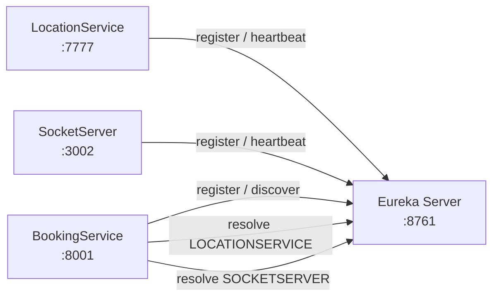

# RideFlow Service Discovery

Service Discovery is RideFlow's **Netflix Eureka Server**. It provides a central registry where participating microservices register themselves and discover other services by logical application name rather than by hardcoded host/port pairs.

## Role in RideFlow



In the current codebase, the Eureka clients are:

- `LocationService`
- `BookingService`
- `SocketServer`

Auth Service and Review Service do not currently include an Eureka client dependency.

## Tech Stack

- Java 17
- Spring Boot 4.1.1
- Spring Cloud 2025.1.3
- Spring Cloud Netflix Eureka Server
- Gradle

## Configuration

The service runs on port `8761` and does not register itself as a client:

```properties
spring.application.name=ServiceDiscovery
server.port=8761

eureka.instance.hostname=my-registry
eureka.client.register-with-eureka=false
eureka.client.fetch-registry=false
```

## Run Locally

### Prerequisites

- JDK 17+

### Start the server

```bash
# Linux/macOS
./gradlew bootRun

# Windows
gradlew.bat bootRun
```

Open the Eureka dashboard:

```text
http://localhost:8761
```

When the RideFlow Eureka clients are running, they should appear in the registered-instances section.

## How Client Services Connect

A typical RideFlow client uses:

```properties
eureka.client.service-url.defaultZone=http://localhost:8761/eureka
eureka.instance.preferIpAddress=true
```

and adds:

```gradle
implementation 'org.springframework.cloud:spring-cloud-starter-netflix-eureka-client'
```

Spring publishes the service under the configured `spring.application.name`.

## Why RideFlow Uses Service Discovery

Without service discovery, Booking Service would need fixed addresses such as:

```text
http://localhost:7777
http://localhost:3002
```

With Eureka, Booking Service can resolve logical service names such as:

```text
LOCATIONSERVICE
SOCKETSERVER
```

This is especially useful when service instances move between hosts, ports, containers, or replicas.

## Project Structure

```text
src/
├── main/
│   ├── java/com/rideflow/servicediscovery/
│   │   └── ServiceDiscoveryApplication.java
│   └── resources/
│       └── application.properties
└── test/
    └── java/com/rideflow/servicediscovery/
        └── ServiceDiscoveryApplicationTests.java
```

The application entry point is annotated with:

```java
@EnableEurekaServer
```

There are no RideFlow business REST controllers in this repository.

## API Documentation

Swagger/OpenAPI is intentionally not added here because this module does not expose RideFlow business APIs. The Eureka dashboard is the primary operational UI.

## Troubleshooting

### Service does not appear in Eureka

Check:

1. Eureka is running on port `8761`.
2. The client has the Eureka client dependency.
3. The client has a non-empty `spring.application.name`.
4. `eureka.client.service-url.defaultZone` points to this server.
5. The client started successfully after its own database/Redis/Kafka dependencies were available.

### `No matches for the virtual host name`

This usually means the caller asked Eureka for a service name that is not currently registered. Verify the name shown in the Eureka dashboard matches the name used by the caller.

## Parent Project

See the complete RideFlow architecture:

[RideFlow](https://github.com/Abhilash-Panja/RideFlow)
